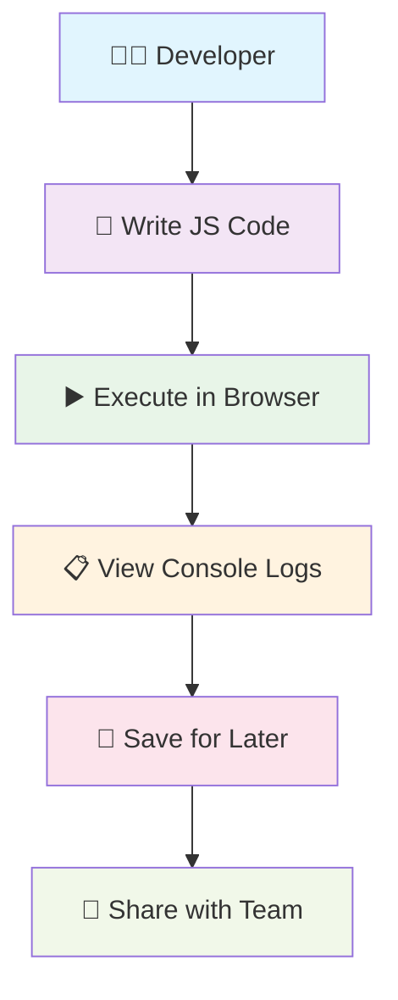
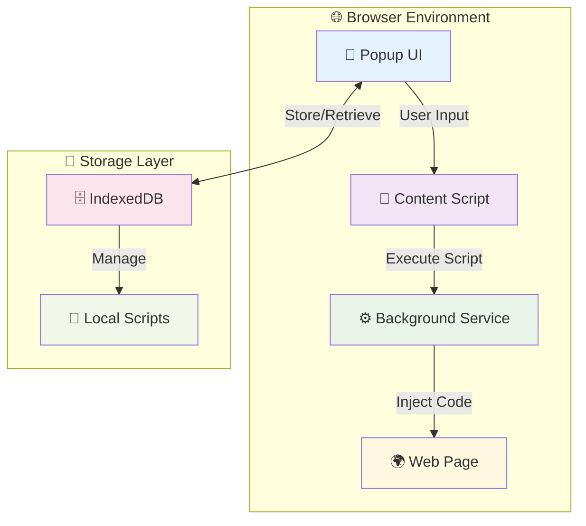
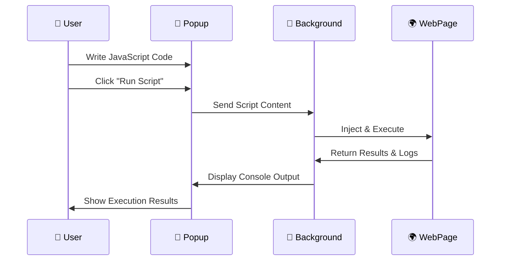
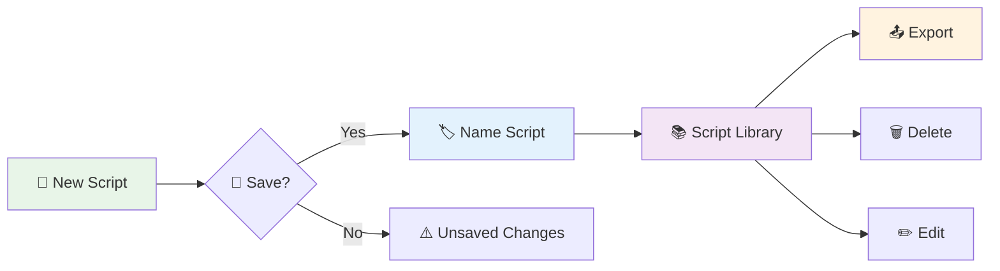
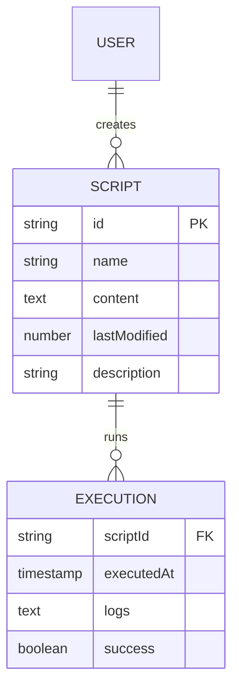
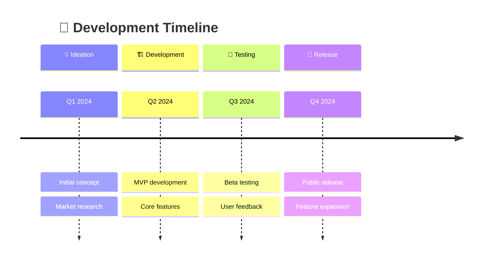

# 🕷️ Shopify Script Debugger

> **Script injections for CS teams made easier** 🚀

A powerful Chrome extension designed for Technical Solutions Consultants, developers, and support engineers who need to quickly test, debug, and manage JavaScript code snippets directly in the browser.


---

## 🎯 Purpose & Vision

### 🤔 Why This Extension Exists?

**Problem**: Technical Solutions Consultants and developers constantly need to:
- 🔍 Debug merchant integration issues
- 📊 Analyze network logs and console outputs  
- 🛠️ Test JavaScript snippets quickly
- 💾 Store and reuse debugging scripts
- 🔄 Share code snippets across different environments

**Solution**: A unified debugging companion that lives in your browser! 



---

## ✨ Key Features

### 🎨 **Smart Code Editor**
- 🌙 **Dark Theme** - Easy on the eyes during long debugging sessions
- 🔍 **Syntax Highlighting** - JavaScript with full IntelliSense
- ⌨️ **Keyboard Shortcuts** - `Ctrl+S` to save, `Ctrl+Enter` to run
- 🔧 **Code Formatting** - Auto-format your messy code

### 💾 **Script Management**
- 📁 **Save & Organize** - Name and store your frequently used scripts
- 🎯 **Quick Access** - Dropdown menu for instant script selection
- 🏷️ **Smart Naming** - Auto-generated names with timestamps
- ⚠️ **Unsaved Changes Detection** - Never lose your work

### 🔄 **Import/Export System**
- 📤 **Export Scripts** - Share your toolbox with teammates
- 📥 **Import Scripts** - Load scripts from CSV files
- 🌐 **Cross-Account Sync** - Move your scripts between Chrome profiles
- 📋 **Bulk Operations** - Select multiple scripts for batch export

### 🔧 **Advanced Execution**
- ⚡ **Instant Execution** - Run scripts with one click
- 📊 **Console Integration** - View logs directly in the popup
- 🎯 **Page Context** - Scripts run in the actual page environment
- 🧹 **Auto Cleanup** - Prevents script conflicts and memory leaks

---

## 🚀 How It Works

### 📐 Architecture Overview



### ⚡ Execution Flow



---

## 🎮 User Guide

### 🏁 Getting Started

1. **📥 Install Extension** 
   ```bash
   # Clone the repository
   git clone https://github.com/your-repo/shopify-script-debugger
   cd shopify-script-debugger
   
   # Install dependencies
   npm install
   
   # Build the extension
   npm run build
   ```

2. **🔧 Load in Chrome**
   - Open `chrome://extensions/`
   - Enable "Developer mode"
   - Click "Load unpacked"
   - Select the extension folder

3. **🎯 Pin Extension**
   - Click the puzzle piece icon in Chrome toolbar
   - Pin "Shopify Script Debugger" for easy access

### 💡 Basic Usage

#### ✍️ Writing Your First Script

```javascript
// 🎯 Example: Check if jQuery is loaded
if (typeof $ !== 'undefined') {
    console.log('✅ jQuery is loaded!', $.fn.jquery);
} else {
    console.log('❌ jQuery not found');
}

// 🔍 Example: Debug Shopify cart
if (typeof Shopify !== 'undefined') {
    console.log('🛒 Cart contents:', Shopify.cart);
} else {
    console.log('🚫 Not a Shopify store');
}
```

#### 💾 Saving Scripts

1. Write your code in the editor
2. Press `Ctrl+S` or click "Save"
3. Give your script a meaningful name
4. Access it anytime from the dropdown! 🎉

#### 🔄 Managing Your Script Library



---

## 🛠️ Technical Implementation

### 🏗️ Project Structure

```
📦 shopify-script-debugger/
├── 📄 manifest.json              # Extension configuration
├── 📁 popup/                     # React-based UI
│   ├── 📁 src/
│   │   ├── 🎨 components/        # React components
│   │   ├── 🔧 hooks/            # Custom React hooks  
│   │   └── 🎯 utils/            # Utility functions
│   └── 📁 build/                # Compiled popup
├── 📁 scripts/                   # Extension scripts
│   ├── ⚙️ background.js         # Service worker
│   ├── 🎯 contentScript.js      # Page injection
│   └── 💾 storageService.js     # IndexedDB operations
└── 📁 icons/                     # Extension icons
```

### 🔧 Core Technologies

- **🎨 Frontend**: React 18 + Tailwind CSS
- **📝 Code Editor**: CodeMirror 6 with JavaScript syntax highlighting
- **💾 Storage**: IndexedDB for local script persistence
- **🏗️ Build**: Webpack + Babel for modern JavaScript
- **🎯 Extension APIs**: Chrome Extensions Manifest V3

### 💾 Data Flow & Storage



---

## 🎯 Use Cases

### 👨‍💼 For Technical Solutions Consultants

```javascript
// 🔍 Debug Shopify theme issues
const themeInfo = {
    name: Shopify.theme.name,
    id: Shopify.theme.id,
    role: Shopify.theme.role
};
console.log('🎨 Current theme:', themeInfo);

// 📊 Check installed apps
const apps = Array.from(document.querySelectorAll('script[src*="app"]'))
    .map(script => script.src);
console.log('📱 Detected apps:', apps);
```

### 🧑‍💻 For Frontend Developers

```javascript
// ⚡ Performance monitoring
const perfData = {
    loadTime: performance.timing.loadEventEnd - performance.timing.navigationStart,
    domReady: performance.timing.domContentLoadedEventEnd - performance.timing.navigationStart,
    resourceCount: performance.getEntriesByType('resource').length
};
console.log('📈 Performance metrics:', perfData);
```

### 🔧 For QA Engineers

```javascript
// 🧪 Form validation testing
const forms = document.querySelectorAll('form');
forms.forEach((form, index) => {
    console.log(`📝 Form ${index + 1}:`, {
        action: form.action,
        method: form.method,
        fields: form.querySelectorAll('input, select, textarea').length
    });
});
```

---

## 🔮 Roadmap & Future Features

### 🎯 Planned Features

- [ ] 🌐 **Cloud Sync** - Sync scripts across devices
- [ ] 🤝 **Team Sharing** - Share script collections with teammates  
- [ ] 📊 **Analytics Dashboard** - Track script usage and performance
- [ ] 🔗 **API Integration** - Connect with external debugging tools
- [ ] 🎨 **Custom Themes** - Personalize the editor appearance
- [ ] 🔄 **Version Control** - Track script changes over time
- [ ] 🤖 **AI Suggestions** - Smart code completion and debugging hints

### 🚀 Version History



---

## 🤝 Contributing

We welcome contributions! Here's how you can help:

### 🐛 Found a Bug?
1. 🔍 Check existing issues
2. 📝 Create detailed bug report
3. 🏷️ Include steps to reproduce

### 💡 Have an Idea?
1. 💭 Discuss in GitHub Discussions  
2. 📋 Create feature request
3. 🗳️ Get community feedback

### 👨‍💻 Want to Code?
1. 🍴 Fork the repository
2. 🌿 Create feature branch
3. ✅ Write tests
4. 📤 Submit pull request

---

## 📄 License

This project is licensed under the MIT License - see the [LICENSE](LICENSE) file for details.

---

## 🙏 Acknowledgments

- 🎨 **CodeMirror** - For the amazing code editor
- ⚛️ **React Team** - For the robust UI framework  
- 🎯 **Chrome Extensions Team** - For the powerful platform
- 🛍️ **Shopify Community** - For inspiration and use cases

---

## 📞 Support & Contact

- 🐛 **Bug Reports**: [GitHub Issues](https://github.com/your-repo/issues)
- 💡 **Feature Requests**: [GitHub Discussions](https://github.com/your-repo/discussions)  
- 📧 **Email**: your-email@example.com
- 🐦 **Twitter**: [@yourhandle](https://twitter.com/yourhandle)

---

<div align="center">

**⭐ Star this repository if it helped you! ⭐**

Made with ❤️ for the developer community

</div>